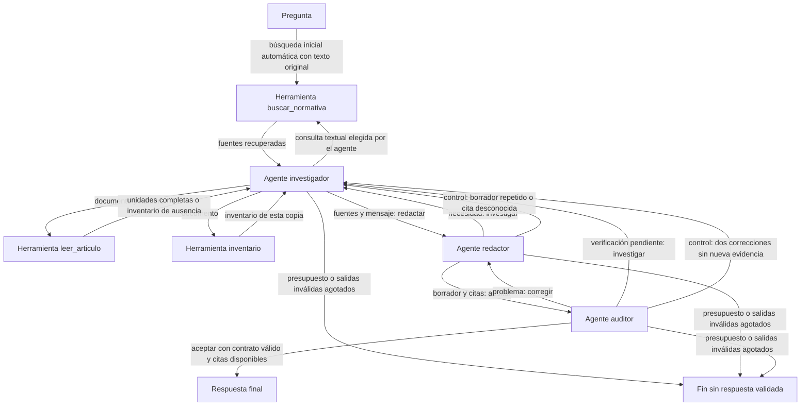

# Deliverable 3 · Sistema nuevo de tres agentes

**Estado vigente, 28-10, ~04:00 Chile:** lote real reanudado en T4 desde 35/300, sin piloto. Se verificó `P06 sin_completitud: ejecutando`. Consultar el estado de trabajo antes de actuar; las notas de interrupción de abajo son históricas.


**Actualización 28 de octubre:** la última descarga es un piloto de 12 respuestas. El lote completo no está activo en la sesión visible; se conservan 35/300 respuestas auditadas. Véase [estado actual](ESTADO_TRABAJO.md).


Implementación desde cero a partir de D1, D2 y la pauta oficial de D3, por decisión del equipo. No importa código, prompts, notebooks, pruebas ni resultados de los prototipos previos de D3. La carpeta de trabajo es **`Deliverable3_Agentes/`**.

**Estado (27 de octubre):** cuatro pilotos reales conservados y evaluados. El [piloto v4](resultados/piloto_6a4e8925ada1fa3d1dee/REPORTE.md) obtuvo agentes 1/4, D2 2/4 y baseline 0/4 con la pauta estricta. Se congeló v4 y **se inició el lote de 50 preguntas × seis condiciones, actualmente pendiente de recuperación**, sin seleccionar resultados favorables. Véase [congelación y reproducción](CONGELACION_V4.md). Faltan completar y evaluar las 300 respuestas, cerrar el PDF y grabar/publicar el video real. Los pilotos son diagnóstico, no generalización.

El [estado de trabajo](ESTADO_TRABAJO.md) registra pendientes. Hay un [borrador PDF, guion y mensajes reales](entrega/README.md); todavía no constituyen la entrega final.

Para continuar con otro modelo de IA, leer la [guía de continuidad](CONTINUAR_CON_IA.md) y el [enunciado oficial](enunciado.pdf). El último respaldo auditado publicado contiene 35/300 respuestas; el progreso posterior de Colab requiere nuevas descargas.

## Empezar en Colab

1. Abre el [notebook actual en Colab](https://colab.research.google.com/github/Pacortes2021/GENERATIVE-ARTIFICIAL-INTELLIGENCE-DELIVERABLE-1/blob/main/Deliverable3_Agentes/Deliverable3_Agentes_Colab.ipynb) o sube [Deliverable3_Agentes_Colab.ipynb](Deliverable3_Agentes_Colab.ipynb) y selecciona GPU. El cuaderno incluye código, prompts externos restaurables, corpus y preguntas; no requiere acceso a los prototipos ni clonar el repositorio.
2. Ejecuta las secciones 1–3. Instala las dependencias fijadas de D2, carga E5 en CPU y una instancia Qwen3-4B en GPU. Los tres agentes comparten esa instancia y los parámetros de generación.
3. «Ejecutar todo» corre el piloto de la sección 5 por defecto: cuatro preguntas en baseline/D2/agentes, doce respuestas finales. La consulta de la sección 4 es opcional. Se muestran salidas JSON, decisiones, mensajes y observaciones de herramientas, además de la respuesta final.
4. La sección 8 crea el ZIP y solicita su descarga; muestra también la ruta para descargarlo desde el panel Archivos si el navegador no lo hace automáticamente. Encuentra corridas parciales aunque `RUN_DIR` no exista; si hay varias, conserva todas dentro de un ZIP contenedor. Para una sesión larga activa Drive antes de cargar el sistema; el almacenamiento temporal de Colab no persiste al cerrar la sesión.
5. Tras revisar el piloto, congela esta versión y activa el lote de 50 preguntas con seis condiciones. Una repetición idéntica reutiliza checkpoints con aviso; para generar de nuevo cambia la etiqueta o la semilla y conserva todas las ejecuciones.

**Las instrucciones anteriores son para una sesión nueva. Si retomas el trabajo del equipo, lee primero el estado actual: hay un lote v4 activo que no debe reiniciarse.** El notebook publicado deja el lote desactivado por defecto; en la sesión activa se habilitó únicamente la sección 6. El piloto lleva la etiqueta `piloto-v4`.

El notebook incluye preparación, consulta, inspección y exportación, sin respuestas precargadas. La construcción no incorpora respuestas de referencia ni los veredictos de D2.

## Tres agentes y decisiones

| Agente | Responsabilidad exclusiva | Entrada | Acciones y salida |
|---|---|---|---|
| Investigador | Reunir evidencia | Pregunta, fuentes ya observadas, borrador y necesidad recibida | `herramienta`: solicitud de lectura/búsqueda/inventario; `redactar`: transferencia de fuentes y mensaje de suficiencia o limitación. |
| Redactor | Elaborar o corregir la respuesta | Pregunta, evidencia y observaciones recibidas | `investigar`: solicitud de información; `auditar`: borrador completo con citas. |
| Auditor | Revisar si el borrador responde y está respaldado | Pregunta, evidencia, borrador y mensaje | `aceptar`: terminar; `corregir`: devolver problema al redactor; `investigar`: pedir comprobación documental. |

Cada agente recibe su propio prompt y devuelve JSON con un contrato validado. Antes de su primera llamada se ejecuta una búsqueda con el texto original; cuenta dentro del presupuesto. El controlador bloquea citas desconocidas y ciclos sin progreso, registrando cuándo cambia una transferencia. Las decisiones del modelo determinan las transferencias: no es una secuencia fija de tres prompts. No se solicita razonamiento privado; las trazas contienen comunicaciones y acciones observables.



Una aceptación interna no demuestra corrección. La validación de un extracto confirma su presencia literal, no la inferencia que el modelo hace a partir de él. Las respuestas finales se califican fuera del sistema con la pauta D2.

## Recursos de D2 conservados

- Corpus: 197 unidades y 201 fragmentos, con identificación y hashes de los tres PDF.
- E5 y política de recuperación de D2; búsqueda densa, expansión a unidades, remisiones e inventarios según su implementación original.
- Prompt directo histórico y prompt RAG estructurado de D2, sin reescritura en las condiciones de control.
- Generador y pauta externa D2. El nuevo controlador, herramientas, prompts de agentes, checkpoints y notebook se escribieron en esta carpeta.

Qwen: `Qwen/Qwen3-4B`, revisión `1cfa9a7208912126459214e8b04321603b3df60c`, NF4, sin thinking. Se conserva el muestreo de D2: temperatura 0,7; top-p 0,8; top-k 20; hasta 1.024 tokens de salida. El dtype de cómputo se elige según la GPU y se registra. El modelo de embeddings E5 es un recurso de búsqueda, no otro agente generativo.

## Técnicas y ablaciones

Los tres prompts de rol y los tres bloques experimentales están en [prompts/](prompts/). El sistema completo concatena el prompt de rol con su bloque; cada ablación omite exactamente un bloque. Los hashes, textos efectivos y mensajes quedan registrados.

| Técnica de prompting | Agente | Fallo que motiva probarla | Variante |
|---|---|---|---|
| Descomposición explícita de la consulta | Investigador | Recuperación de una sola parte o falta de evidencia pertinente, como P38 | `sin_descomposicion` |
| Lista explícita de completitud y remisiones | Redactor | Omisión de excepciones y remisiones sin desarrollar, como P11/P24/P25/P36 | `sin_completitud` |
| Verificación explícita por afirmación | Auditor | Atribuciones sin respaldo, contradicciones y añadidos incorrectos | `sin_verificacion` |

Se mantienen roles, herramientas, esquema JSON, límites y parámetros en las ablaciones. `sin_descomposicion` retira las instrucciones del investigador; **no elimina las subconsultas deterministas ya presentes en D2**. `sin_verificacion` mantiene un auditor genérico y los controles estructurales del programa. Los resultados medirán la contribución incremental de esos bloques, no la desaparición total de esas capacidades ni la utilidad de quitar un agente.

Las seis condiciones son baseline directo, RAG D2, agentes completos y las tres ablaciones. Son 300 respuestas finales sobre 50 preguntas, con más llamadas por respuesta en los sistemas de agentes. El lote puede requerir varias sesiones de Colab; todavía no se ha medido su duración.

## Límites y trazabilidad

Por consulta de agentes: 12 llamadas al modelo, 6 solicitudes de herramienta (incluida la búsqueda inicial), 3 salidas inválidas, 8.192 tokens de contexto, 1.024 de salida y 64 de margen. Evidencia: hasta 28 unidades y 30.000 caracteres. El controlador mide tokens reales antes de cada llamada; no trunca artículos para encajarlos. Las herramientas son de lectura y validan sus argumentos. Las solicitudes idénticas se bloquean durante la misma consulta.

El resultado conserva todos los borradores, llamadas, semillas, mensajes, observaciones y límites. Los errores de infraestructura se registran y detienen la ejecución, sin transformarse en falsas abstenciones. Los checkpoints válidos permiten reanudar llamadas ya completadas. Los tiempos lógicos incluyen el costo original de llamadas reutilizadas; se distinguen de las llamadas nuevas y del tiempo de pared del intento actual.

Cada ZIP incluye código/corpus congelados, prompts, configuración, CSV, resultados JSON y trazas parciales. Los hashes comprueban integridad, no autoría. `audit_zip` comprueba también la correspondencia entre respuestas originales y CSV.

## Reproducir desde el repositorio

Desde la raíz, con Python 3.10+ y GPU CUDA para inferencia:

```bash
python3 -m pip install -r Deliverable3_Agentes/requirements.txt
python3 Deliverable3_Agentes/ejecutar.py --ids 5 25 38 41 --variantes baseline_directo rag_d2 agentes_completo --etiqueta piloto-v4
python3 Deliverable3_Agentes/ejecutar.py --todas --etiqueta lote-v4 --silencioso
```

Construcción y pruebas sin GPU (requieren `numpy` y `nbformat`; no descargan modelos):

```bash
python3 Deliverable3_Agentes/crear_cuaderno.py
python3 -m unittest discover -s Deliverable3_Agentes/tests -v
```

La evaluación externa y el cierre de entrega están descritos en [EVALUACION.md](EVALUACION.md). Las comprobaciones locales y sus límites están en [VALIDACION.md](VALIDACION.md).
